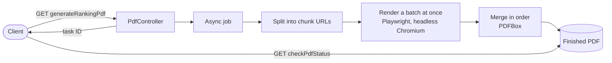

# pdf-generator

A Spring Boot service that turns a page too long for one browser print into a single PDF.

Printing a very long page in one go is slow and can run out of memory. This service asks your site
for the page in chunks, renders each chunk with headless Chromium, and merges the results. The caller
gets a task ID straight away and polls until the file is ready.



## How it works

1. `GET /api/v1/generateRankingPdf` creates a task and returns right away. Your cookies are passed on,
   so it can render pages behind a login.
2. The articles are split into chunks, 200 per PDF by default.
3. Chunks render in batches, two at a time by default, each in its own browser.
4. PDFBox merges the chunks in order and the temporary files are deleted.
5. A scheduled job removes finished PDFs after 30 minutes.

## Run it

You need Java 17. Chromium downloads on the first render.

```bash
export PDF_RANKING_ROOT=https://your-site.example/export
export PDF_RANKING_DOMAIN=your-site.example
export CORS_ALLOWED_ORIGIN=https://your-site.example
./mvnw spring-boot:run -Dspring-boot.run.arguments=--pdf.storage.path=./generated_pdfs
```

Each chunk is fetched from `{PDF_RANKING_ROOT}/{offset}/{limit}?dataUrl={dataUrl}`.

```bash
curl "localhost:8080/api/v1/generateRankingPdf?dataUrl=report-1&numberOfArticles=1200"
# {"taskId":"/api/v1/checkPdfStatus?taskId=<id>"}

curl -o report.pdf "localhost:8080/api/v1/checkPdfStatus?taskId=<id>"
# 204 while rendering, then the PDF
```

## Configuration

| Setting | Default | What it does |
|---|---|---|
| `pdf.ranking.articles-per-pdf` | 200 | Articles in each chunk |
| `pdf.ranking.batch-size` | 2 | Chunks rendered at the same time |
| `pdf.pages-to-remove` | 2 | Pages dropped from the end of each chunk, for trailing blank pages. Set it to 0 if you have none |
| `pdf.storage.path` | `/data/generated_pdfs` | Where PDFs are written |
| `pdf.cleanup.file-retention-duration-ms` | 1800000 | How long finished PDFs are kept |

## Good to know

- A chunk that fails is logged and skipped, so the merged PDF would be missing that part.
- If every chunk fails, the task stays pending.
- The endpoints have no authentication of their own. Run it behind something that does.
- The only automated test is a Spring context check. I checked rendering and merging by running a
  1,200-article job against a local test site and comparing page counts.
